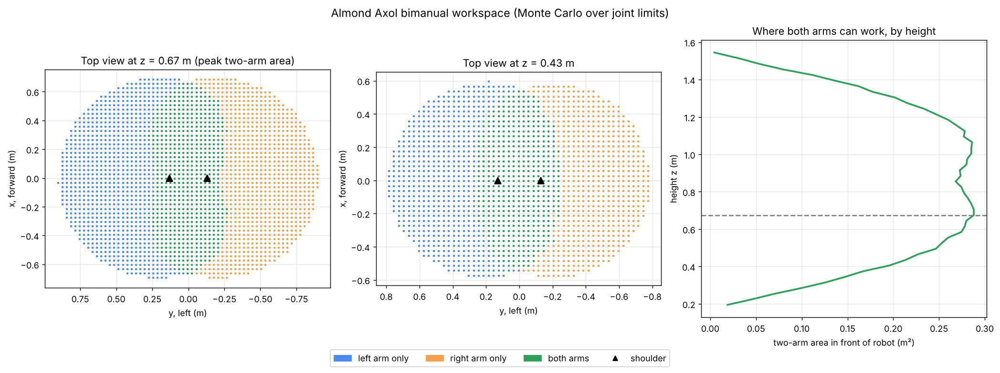

# Axol Bimanual Workspace Map

A quick tool for anyone setting up an [Almond Axol](https://almond.bot): it maps where the left arm, the right arm, and **both arms** can reach, and shows which table heights give you the most two-arm workspace.



## Run it

```
pip install numpy matplotlib
python axol_workspace.py axol.urdf
```

`axol.urdf` is copied from Almond's open-source SDK ([almond-bot/axol](https://github.com/almond-bot/axol), `almond_axol/kinematics/urdf/axol.urdf`, MIT license). No robot, JAX, or ROS needed. It takes about 30 seconds.

## How it works

1. **Read the URDF.** Pull out each joint's offset, rotation axis, and limits, then follow the chain from the base to each gripper (7 joints per arm).
2. **Sample.** Pick 3 million random joint configurations per arm, each angle uniform within its limits.
3. **Forward kinematics.** Multiply the joint transforms down the chain to get where each gripper ends up. Done in batches with numpy, so it's fast.
4. **Voxelize.** Drop the gripper positions into 3 cm cubes. A cube counts as reachable for an arm if any sample landed in it. "Both arms" is the overlap.
5. **Slice by height.** For each height, measure how much two-arm area is in front of the robot (x > 0), since that's where a table would go.

## Results

```
Joints per arm:          7 (left), 7 (right)
Max reach from shoulder: 781 mm (left), 781 mm (right)
Two-arm volume:          0.534 m³ (24% of total)
Shared area in front of the robot peaks at 0.29 m²
Heights within 90% of that peak: 0.55 to 1.18 m (z measured from the URDF root; shoulders sit at 0.86 m)
```

What this says in plain terms: the zone where both arms can work together is a strip about 50 cm wide down the middle, and it stays about the same size across a wide band of heights, from roughly 30 cm below the shoulders to 30 cm above them. So a table anywhere in that band works for two-handed tasks. Put objects in the middle strip, not off to the sides.

## Limits (things I'd want to check with the Almond team)

- **Reach is 781 mm here vs 860 mm on the spec sheet.** The URDF ends at the gripper mount frame, so the difference is probably the fingers. Worth confirming.
- **No collision checking.** Some sampled poses would hit the robot's own body or the other arm, so the real workspace is a bit smaller, especially close to the torso and behind the robot.
- **Reachable, not dexterous.** A cube counts if the gripper can get there in *any* orientation. A version that only counts poses where the gripper points down (for picking) would be a useful next step, and the SDK's IK solver could do that.
- **Monte Carlo.** The edges of each region are slightly ragged because sampling is random. More samples (`--samples`) smooth it out.

## How this was made

Venkat Narayanan built this with Claude in an afternoon. The forward kinematics is the same math used for odometry and arm control on VEX robots, just in 3D with seven joints instead of two.
