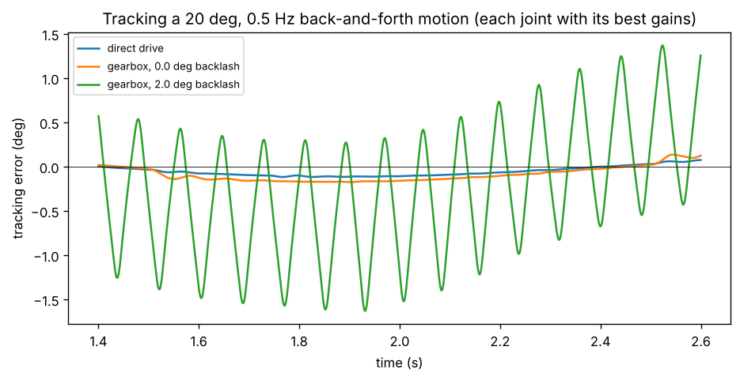

# Gearbox backlash vs direct drive, under PID

A small simulation I wrote after reading about Vassar Robotics' gearless joints. Gear slop is a
familiar problem in VEX arm and lift code, so I wanted to see in numbers how
backlash limits a PID-controlled joint compared with a direct drive.

```
pip install numpy matplotlib
python joint.py                    # tunes each joint and prints the table below (about 30 s)
python joint.py --plot example.png # also saves the plot
```



## The model

- **The joint:** one horizontal link (0.02 kg·m²) with friction, a 14-bit encoder on the joint
  output, and a 2 kHz PID loop with a filtered derivative.
- **Geared joint:** a small motor through a 30:1 gearbox. The gear mesh has finite stiffness, a
  backlash dead zone, and more friction.
- **Direct-drive joint:** a larger motor with more rotor inertia, rigidly attached, less friction.
- **Two tests:** track a 20°, 0.5 Hz back-and-forth motion, and hold a position through a short
  bump.
- **Fair comparison:** each joint gets its own best PID gains from a grid search, choosing the
  lowest tracking error that still holds position with less than 0.2° of wobble.

## Results

| joint | best gains (kp / kd / ki) | tracking RMS error | worst error at a reversal | holding wobble |
|---|---|---|---|---|
| direct drive | 240 / 0.5 / 100 | 0.08° | 0.06° | 0.00° |
| gearbox, no backlash | 240 / 0.5 / 100 | 0.13° | 0.14° | 0.01° |
| gearbox, 0.5° backlash | 60 / 0.5 / 100 | 0.51° | 0.57° | 0.04° |
| gearbox, 1° backlash | 30 / 0.5 / 100 | 0.82° | 1.01° | 0.07° |
| gearbox, 2° backlash | no stable gains found | 0.76° | 1.39° | 1.87° (limit cycle) |

## What I took from it

- **Backlash's real cost is the gains you can no longer use.** Even half a degree forced the
  proportional gain down 4x to stop the joint from hunting, and tracking error went up about 4x.
  The error isn't just "the backlash size". It's the backlash plus a softer controller.
- **At 2° there were no stable gains at all** in the search: the joint settles into a
  steady buzz (about 12 Hz in the plot) as it bangs across the dead zone.
- **Direct drive was best everywhere**, but only about 1.6x better than a perfect gearbox. Most
  of the gap comes from the backlash, not from having gears.

Simplifications: one joint, no gravity, no motor electrical dynamics or torque ripple (direct
drive's usual weak spot), and a simple grid search for gains. The next things I'd add are gravity
loading, which keeps a geared joint pressed against one side of its backlash, and cogging torque
on the direct-drive motor.

Built with help from Claude.
