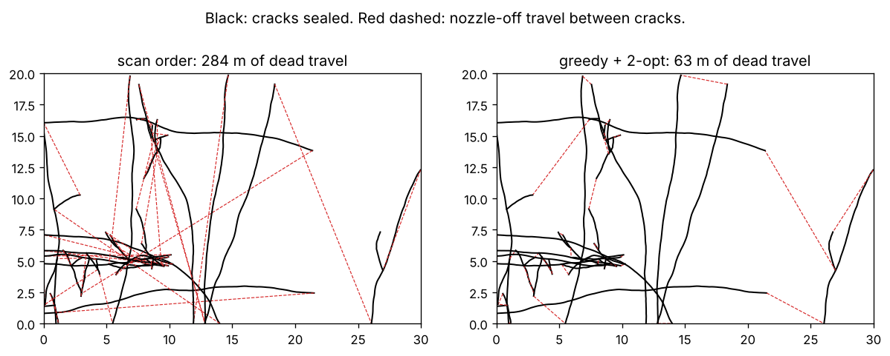

# How much driving does a crack-sealing robot waste between cracks?

A small routing study I did after reading about Pave Robotics. A crack-sealing robot spends some
of its time sealing, which is fixed by the total crack length, and some driving between cracks
with the nozzle off. That second part depends entirely on the order it does the cracks in and
which end of each crack it starts from.

```
pip install numpy matplotlib
python route.py                    # 20 random lots, prints the tables below
python route.py --plot example.png # also saves the comparison
```



## The setup

- **The lot:** 30 m by 20 m, with random crack networks of long transverse and longitudinal cracks
  plus short branches, about 265 m of cracks per lot.
- **Speeds:** the robot seals at 0.15 m/s and moves at 1 m/s between cracks.
- **Four ways to order the work:**
  1. **Scan order:** cracks sorted by where they start, as they'd come off a scan.
  2. **Scan order plus flipped ends:** same order, but each crack starts from its nearer end.
  3. **Greedy:** always go to the closest unsealed crack end next.
  4. **Greedy plus 2-opt:** then repeatedly reverse chunks of the route when that shortens travel.

## Results (median of 20 lots)

| route | nozzle-off travel | job time | travel vs scan order |
|---|---|---|---|
| scan order | 326 m | 35.0 min | baseline |
| scan order + flip ends | 198 m | 32.9 min | -40% |
| greedy nearest | 93 m | 31.0 min | -72% |
| greedy + 2-opt | 77 m | 30.8 min | -77% |

Share of the job spent driving with the nozzle off:

| sealing speed | scan order | greedy + 2-opt |
|---|---|---|
| 0.15 m/s | 15% | 4% |
| 0.3 m/s | 26% | 8% |
| 0.6 m/s | 42% | 15% |

## What I took from it

- **Simply starting each crack from its nearer end cut wasted travel by 40%.** It's almost free to
  do, since the order stays the same.
- **Greedy routing gets most of the win (72%)**, and 2-opt adds a little more on top. For a few
  dozen cracks, both run in milliseconds.
- **Today it only saves about 4 minutes per lot,** because sealing time dominates. But as sealing
  gets faster, routing matters more: at 0.6 m/s, a scan-order robot would spend 42% of its time
  driving between cracks, versus 15% for an optimized route.

Simplifications: point robot with no turning radius, straight-line moves between cracks, made-up
crack patterns, and no obstacles or parked cars. Next I'd add the robot's real turning
constraints and cracks that meet at junctions, where sealing through a junction once matters.

Built with help from Claude.
