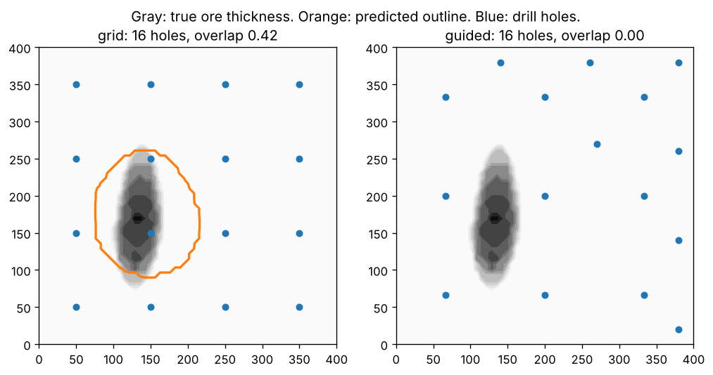

# Finding an ore body from a few drill holes

A small experiment on a question I read about while looking at Mineflow: when you only have a few
drill holes, how well can you estimate the size and shape of an ore body, and does choosing the
next hole cleverly beat just drilling a grid?

```
pip install numpy matplotlib
python orebody.py                    # 12 random ore bodies per setting, prints the table below
python orebody.py --plot example.png # also saves the comparison picture
```



## The setup

- **A hidden ore body**: a tilted, lumpy lens of high-grade rock somewhere under a 400 m by 400 m
  claim, down to 300 m deep. Size, angle and position are random each trial.
- **Drill holes**: vertical, sampling grade every 5 m with some assay noise.
- **The model**: a Gaussian process (the math behind kriging) that turns the samples into a grade
  estimate everywhere, plus how unsure it is. Rock above 1.0 g/t counts as ore.
- **Two ways to drill**:
  - *grid*: evenly spaced holes.
  - *guided*: a 3x3 scouting grid, then each next hole goes where the model is least sure whether
    the rock is above the cutoff (the "straddle" rule from Bryan et al., 2005).

## Results (12 ore bodies per setting)

| holes | strategy | median volume error | median overlap with true shape |
|---|---|---|---|
| 16 | grid | 63% | 0.34 |
| 16 | guided | 67% | 0.22 |
| 25 | grid | 20% | 0.45 |
| 25 | guided | 48% | 0.39 |
| 36 | grid | 24% | 0.68 |
| 36 | guided | 22% | 0.72 |

Overlap is intersection over union (1.0 = perfect match).

## What I took from it

- **The guided rule lost to a plain grid until 36 holes.** I expected the opposite.
- **The picture shows why.** When the 3x3 scouting holes all miss a narrow ore body, the model
  thinks the whole claim is barren, so "least sure about the cutoff" points at the edges of the
  claim, not at the ore. The guided holes end up spread around the border. A grid at the same
  count happens to land a hole in the ore.
- **Once a scout hits ore, guided drilling does well**: it puts holes around the edge of the body,
  which is where the volume estimate is decided. That's why it catches up at 36 holes.
- **With fewer than about 25 holes, volume estimates were off by half or more** either way. Narrow
  bodies fall between holes.

Things I'd try next: spending the first holes on pure exploration (largest uncertainty, ignoring
the cutoff) before switching to the edge-finding rule, fitting the model's length scales from the
data instead of fixing them, and angled holes. This uses made-up geology, so the numbers only
compare the two strategies against each other.

Built with help from Claude.
