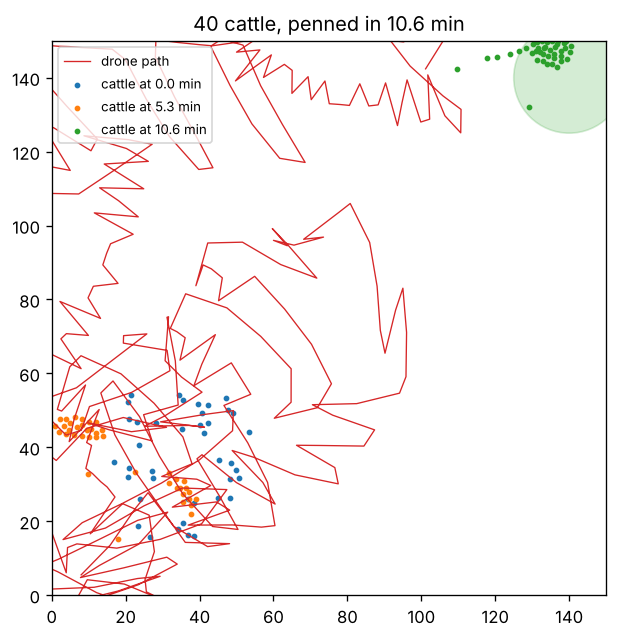

# One drone, one herd: a herding simulator

A small simulation of a single drone moving cattle into a pen, built after reading about Brumby's
drone herding. I wanted to see where a simple strategy breaks as the herd gets bigger.

```
pip install numpy matplotlib
python herd.py                    # 50 to 200 runs per setting, prints the table below
python herd.py --plot run.png     # also saves one example run
```



## The model

**Cattle** (150 m by 150 m field) each:
- stay near their 10 nearest neighbors
- keep about 2 m of personal space
- wander randomly
- move away from the drone when it's within 30 m (top speed 2.5 m/s)

**The drone** uses the collect-and-drive rule from shepherding research (Strömbom et al., 2014):
- If any animal has strayed beyond 2·N^(2/3) meters from the herd's center, fly behind the worst
  stray and push it back in.
- Otherwise, get behind the whole herd and push it toward the pen.

A run counts as a success when 90% of the herd is inside the pen (15 m radius) within 30 minutes.

## Results (50 runs per setting)

| cattle | drone speed | penned in 30 min | median time |
|---|---|---|---|
| 20 | 4 m/s | 100% | 4.4 min |
| 20 | 6 m/s | 100% | 4.3 min |
| 20 | 10 m/s | 100% | 4.7 min |
| 40 | 4 m/s | 48% | 17.3 min |
| 40 | 6 m/s | 78% | 13.9 min |
| 40 | 10 m/s | 84% | 15.9 min |
| 80 | 4 to 10 m/s | 0% | none |

## What I took from it

- **Doubling the herd from 20 to 40 roughly triples the time**, and success drops below 100%.
- **At 80 head, one drone never finishes.** In the runs I watched, the herd splits into two
  groups, and the drone keeps switching between collecting one group and driving the other.
  You can see the zigzag in the example plot.
- **Speed helps less than I expected.** Going from 6 to 10 m/s barely changes the median time,
  because the cattle's own speed and how bunched they stay are the real limits.

Next I'd try two drones (one collecting, one driving) and a lower flying height that scares
fewer animals at once. I'd also want to calibrate the fear distance and cattle speed against
real footage, since this model just uses guesses for those.

Built with help from Claude.
