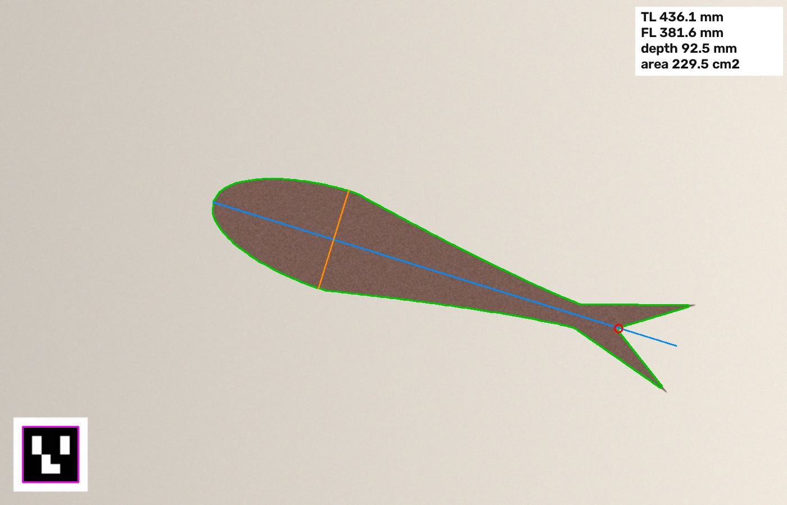

# Fish Measure

Measure a fish from a single phone photo: total length, fork length, body depth, and side area. Lay the fish on a plain board next to a printed ArUco marker, take the photo from straight above, and run:

```
pip install opencv-contrib-python numpy
python fish_measure.py photo.jpg --marker-mm 50
```

You get the numbers as JSON and an annotated image showing the outline, the long axis (blue), the body depth line (orange), and the tail fork (red circle).



## How it works

1. **Scale.** The marker's known size gives millimeters per pixel, so the camera doesn't need calibrating. If the marker shows up as a skewed square, the photo was taken at an angle and the script warns you.
2. **Outline.** The board color is sampled from the image edges, everything that differs enough from it (Otsu threshold in Lab color) is foreground, and the biggest blob that isn't the marker is the fish.
3. **Long axis.** PCA on the outline points gives the fish's long axis. Total length is the outline's extent along it.
4. **Body depth.** The outline is sliced into 80 strips along the axis, and the widest strip is the body depth. The deepest point also tells head from tail, since it sits closer to the head on almost every fish.
5. **Fork.** The tail fork is a dent in the outline, found with convex-hull defects in the last quarter of the fish. The corners where the fin meets the peduncle are dents too, so it picks the one on the centerline. A rounded tail has no dent, and the script reports no fork length instead of guessing.

## Accuracy on synthetic photos

`synthetic_test.py` draws 60 trout-shaped fish (25 to 45 cm) at random sizes, rotations, and positions, with uneven lighting, sensor noise, and a 50 mm marker, then compares the measurements to the true sizes:

| | mean error | 95th percentile | max |
|---|---|---|---|
| Total length | 0.32% | 0.79% | 1.09% |
| Fork length | 1.21% | 1.70% | 1.94% |
| Body depth | 1.29% | 1.89% | 2.00% |

Getting fork length right took two tries. The first version picked the deepest dent in the tail and was 13% off on fish with a shallow fork, because the corner where the fin meets the peduncle was deeper than the fork itself. Restricting it to the dent on the centerline fixed that.

## Not tested yet

- **Real photos.** These numbers come from clean synthetic images. Wet, shiny fish, fins that blend into the board, and shadows will all be harder.
- **Curved fish.** Length is measured along a straight axis, so a fish lying bent comes out short. A midline-skeleton length would fix that.
- **Fins.** Pectoral and dorsal fins that stick out can inflate body depth.

## How this was made

Venkat Narayanan built this with Claude. It came out of reading about OctaPulse's phenotyping work and wanting to see how far one photo and a printed marker can get.
