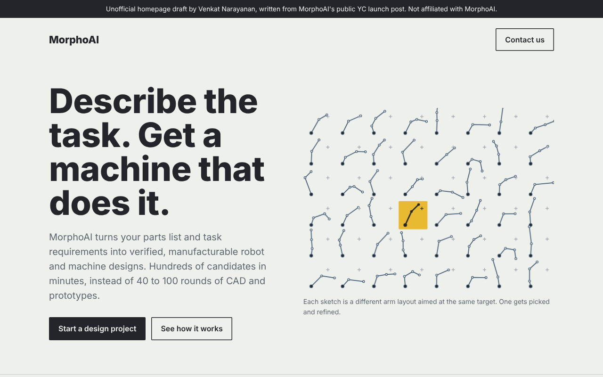

# MorphoAI homepage draft (unofficial)

morpho.ai currently shows only the company name. This is a one-page homepage draft written entirely from MorphoAI's public [YC launch post](https://www.ycombinator.com/launches/NT4-morphoai-ai-powered-computer-aided-invention-for-robotics-and-machine-engineering), offered free to use, change, or ignore.

Open `index.html` in a browser to see it. It's one self-contained file and works on phones.

## Choices

- **The hero shows the product's core idea instead of describing it:** a field of 48 different arm layouts aimed at the same target, with one picked. That's "hundreds of candidates, choose one" in a single picture. The sketches are drawn in code, so there are no images to host.
- **Copy stays inside what the launch post claims:** generate, simulate, optimize; the three outputs (design, motions, BOM); the three use cases; the team; the ARIA grant. Nothing invented.
- **Plain, engineer-facing wording.** The audience is robotics and hardware teams, so it says what goes in and what comes out.

The banner at the top marks it as an unofficial draft. Delete that line if you use it.

## How this was made

Venkat Narayanan made this with Claude in an afternoon.
