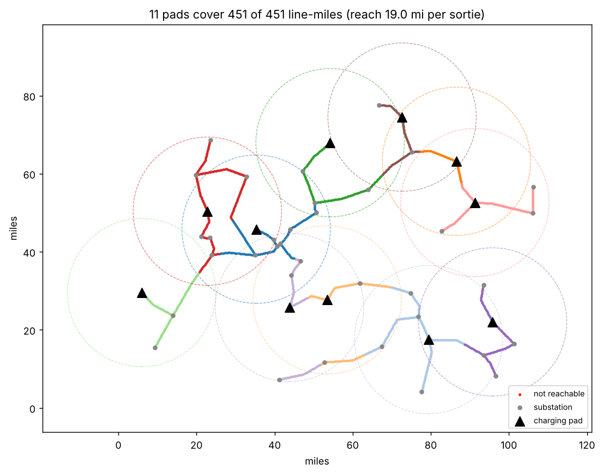

# Pad Planner

Where should the charging pads go? Given a utility's transmission lines and its substations, this picks the fewest substations to host pads so every mile of line is within a drone's round-trip reach.

```
pip install numpy matplotlib
python pad_planner.py --demo                                  # synthetic network
python pad_planner.py --geojson grid.geojson --range 85 --reserve 0.2 --inspect 30
```



The map above is a **synthetic** 451-mile network with 46 substations, not real utility data.

## The model

- **Usable range** = range × (1 − reserve). The default is 85 mi (Faraday-1's listed range) with 20% held back.
- A stretch of line is **reachable** from a pad if the drone can fly out to it, inspect `--inspect` miles of line, and fly back: `2 × distance + inspect ≤ usable range`.
- **Pad selection** is greedy set cover on line-miles: pick the substation that covers the most uncovered line, then repeat. It's simple, fast enough for a whole state, and provably close to optimal for this kind of problem.
- Lines are sampled every 0.25 mi. Each pad reports the line-miles it owns and its average flight distance, and any line out of reach of every substation is flagged in red.

## What the sweep shows

How the number of pads changes with how much line each sortie inspects (demo network, 85 mi range, 20% reserve):

| Line inspected per sortie | Reach | Pads | Line-mi per pad | Circle area per pad |
|---|---|---|---|---|
| 0 mi | 34 mi | 5 | 90 | 3,632 sq mi |
| 10 mi | 29 mi | 7 | 64 | 2,642 sq mi |
| 20 mi | 24 mi | 8 | 56 | 1,810 sq mi |
| **30 mi** | **19 mi** | **11** | **41** | **1,134 sq mi** |
| 40 mi | 14 mi | 16 | 28 | 616 sq mi |
| 50 mi | 9 mi | 32 | 14 | 254 sq mi |

Voltair says each pad covers about 1,000 sq mi. With an 85 mi range and a 20% reserve, that matches about **30 miles of line inspected per sortie**, the bolded row. That's my reading of the numbers, not something Voltair has said.

## GeoJSON input

A FeatureCollection with `LineString` or `MultiLineString` features for lines, and `Point` features with `"substation": true` (and an optional `"name"`) for candidate pad sites. `test_geojson.py` exports the demo network to GeoJSON and checks that loading it back gives the same plan.

## What it leaves out

- Terrain, no-fly zones, and wind (wind changes the usable range by direction).
- Revisit frequency. It covers every line once. A version that minimizes pads while meeting a required inspection interval per line would be closer to how utilities think about it.
- Pads on poles or towers between substations (Voltair's YC post mentions pole-mounted pads). Adding pole sites as extra candidates is a one-line change.

## How this was made

Venkat Narayanan built this with Claude.
