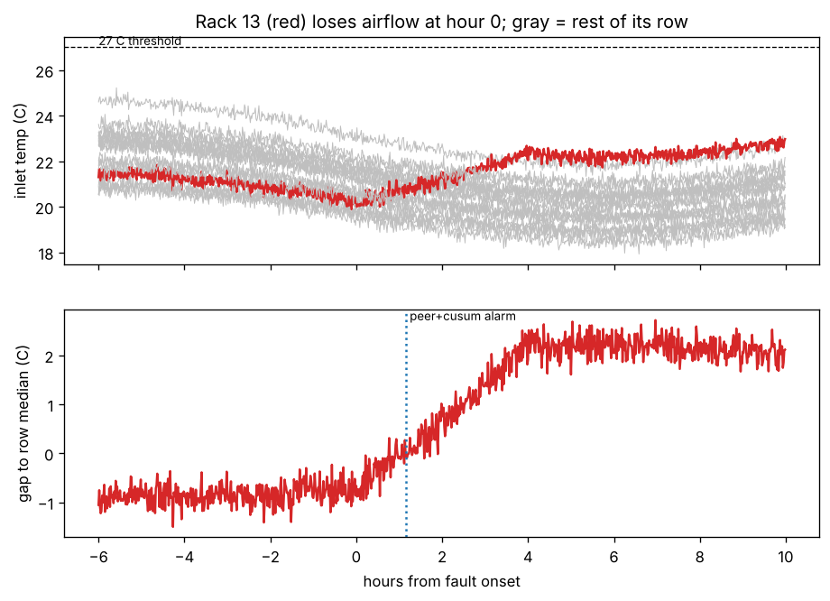

# Catching rack hotspots early by comparing racks to their neighbors

A small experiment I built after reading about Aravolta's data-center monitoring. The question:
can you catch a developing hotspot well before it crosses a fixed temperature alarm, without
drowning operators in false alarms?

```
pip install numpy matplotlib
python hotspots.py                    # 40 simulated two-week periods, prints the table below
python hotspots.py --plot example.png # also saves the example below
```



## The simulated data hall

- 2 rows of 20 racks, one inlet temperature reading per rack per minute, for 2 weeks.
- Inlet temperature = cooling supply air (swings with the daily load) + some recirculated hot air
  (more when a rack and its neighbors draw more power) + a fixed offset per position (some spots
  just run warmer) + sensor noise.
- One fault per week, at a random rack and time:
  - **airflow**: a missing blanking panel or blocked tile; the inlet creeps up 3 °C over 4 hours
  - **stuck sensor**: the reading freezes
  - **row-wide warming**: a cooling unit degrades and a whole row rises 2.5 °C

## Three detectors

1. **Threshold**: alarm above 27 °C, the top of ASHRAE's recommended inlet range.
2. **Peer**: each rack's gap to the median of its row, compared with what that gap normally is
   for that rack (learned on day 1). The daily swing and supply-air changes cancel out because
   the whole row moves together.
3. **Peer + CUSUM**: the same gap fed into a CUSUM, which adds up small, steady drifts until they
   cross a limit. Plus a check for readings frozen for 30 minutes, and a row-vs-row comparison.

## Results (40 simulated fortnights, 80 faults)

| detector | airflow fault | stuck sensor | row-wide warming | false alarms per week |
|---|---|---|---|---|
| threshold 27 °C | 8% caught | 0% caught | 36% caught, median 7 h | 11.5 |
| peer | 100% caught, median 78 min | 100%, median 4.9 h | 0% | 0.1 |
| peer + CUSUM | 100% caught, median 71 min | 100%, 30 min | 100%, 40 min | 2.8 |

## What I took from it

- **A fixed threshold is both late and noisy.** Most faults raise a rack a few degrees but leave it
  under 27 °C, so it never fires, while racks in naturally warm spots trip it during the daily peak.
- **Comparing a rack to its row is the big win.** Everything that affects the whole row (time of
  day, supply air) cancels, so a 1 to 2 °C change at one rack stands out clearly.
- **But peer comparison is blind to the whole row warming**, because the row median moves with it.
  That needed its own check (row vs row). With only one other row to compare against, that check
  would be fooled if both rows warmed at once; a real hall would compare against supply-air and
  return-air sensors too.
- **A stuck sensor looks normal at first.** The peer detector only noticed after the rest of the
  row drifted away from the frozen value, hours later. A simple "hasn't changed in 30 minutes"
  rule caught every one in 30 minutes.

All of this is on simulated data with made-up but plausible numbers. The next step would be real
telemetry, where sensors are noisier, racks get moved, and maintenance causes expected spikes.

Built with help from Claude.
