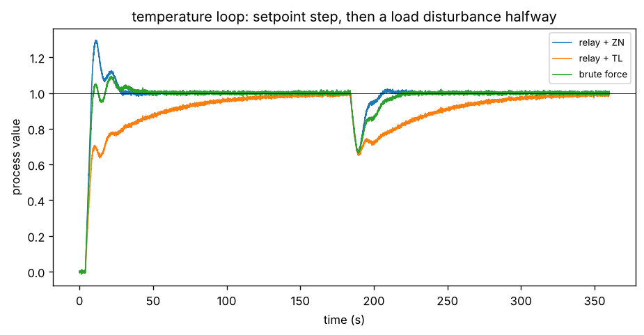

# Relay autotuning vs hand tuning on simulated plant loops

A small study I did after reading about Neuron Industries' AI-native industrial controller.
Many PLC and process controllers offer one-button "autotune", and the classic method behind it is
the relay test (Åström and Hägglund, 1984). I wanted to see how good it actually is compared with
gains found by brute force, and where it breaks.

```
pip install numpy matplotlib
python autotune.py                    # prints the tables below (about 1.5 min)
python autotune.py --plot example.png # also saves an example
```



## How it works

1. **Relay test.** Swap the PID controller for an on/off relay for a few cycles. The loop
   oscillates steadily, and that oscillation's amplitude and period give the process's
   "ultimate" gain Ku and period Pu.
2. **Tuning rules.** Turn Ku and Pu into PID gains with either Ziegler-Nichols (ZN, the textbook
   rule) or Tyreus-Luyben (TL, more conservative).
3. **Brute force.** For comparison, search over gains using full knowledge of the plant, keeping
   only gains with under 10% overshoot.

**The plants** are four first-order-plus-dead-time processes, the standard model for flow, level
and temperature loops, with sensor noise.

**Each loop is scored** on a setpoint step plus a load disturbance, and then re-run on a plant
that has drifted (gain and dead time both 30% worse) to check it stays stable.

## Results

How accurate is the relay test? Estimated vs exact ultimate gain:

| process | Ku estimated | Ku exact | error | Pu error |
|---|---|---|---|---|
| fast flow loop | 6.79 | 11.12 | -39% | +19% |
| level loop | 5.63 | 8.18 | -31% | +5% |
| temperature loop | 2.06 | 2.54 | -19% | 0% |
| dead-time heavy | 1.45 | 1.52 | -5% | -3% |

Loop performance (IAE = integrated absolute error, lower is better):

| process | tuning | IAE | overshoot | still stable after +30% drift |
|---|---|---|---|---|
| fast flow loop | relay + ZN | 1.32 | 39% | yes |
| | relay + TL | 1.60 | 2% | yes |
| | brute force | 1.19 | 10% | yes |
| level loop | relay + ZN | 4.87 | 60% | **no** |
| | relay + TL | 5.66 | 5% | yes |
| | brute force | 4.92 | 7% | yes |
| temperature loop | relay + ZN | 12.77 | 30% | yes |
| | relay + TL | 37.50 | 1% | yes |
| | brute force | 12.89 | 9% | yes |
| dead-time heavy | relay + ZN | 10.63 | 16% | yes |
| | relay + TL | 48.71 | 0% | yes |
| | brute force | 9.89 | 7% | yes |

## What I took from it

- **The relay test is most wrong on fast loops,** underestimating Ku by 39% on the flow loop. The
  relay's square wave isn't the clean sine wave the math assumes, and that matters most when dead
  time is small. It worked well (within 5%) on the dead-time-heavy loop.
- **Ziegler-Nichols gets low error but overshoots 16 to 60%,** and on the level loop it went
  unstable once the plant drifted 30%. That's a real risk for a one-button tool, since plants do
  drift.
- **Tyreus-Luyben is safe but sluggish**: almost no overshoot, but 3 to 5 times the error on the
  slow, dead-time-heavy loops, because its integral action is very slow.
- **Neither rule matched brute force everywhere.** Brute force had similar error to ZN with a
  fraction of the overshoot. That gap, between one relay test and gains that know the plant, is
  where a smarter autotuner could help most.

Simplifications: linear first-order-plus-dead-time plants only, no valve stiction or saturation
effects beyond a simple clamp, and a coarse grid for the brute-force search.

Built with help from Claude.
