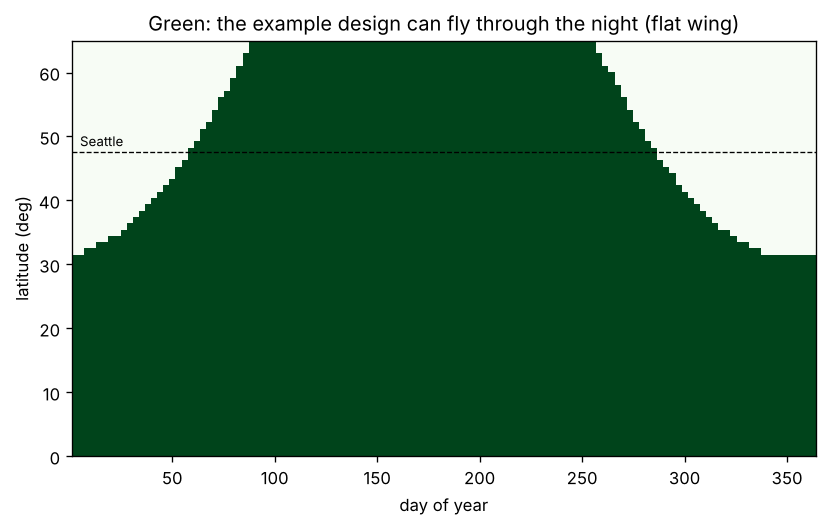

# Can a solar aircraft fly through the night? Latitude vs season

An energy-balance study I did after reading about Radical's StratoSats. A solar aircraft at about
20 km has to store enough daytime energy to fly through the night. I wanted to see where on Earth,
and when, that works, and which design change helps most.

```
pip install numpy matplotlib
python endurance.py                    # prints the tables below
python endurance.py --plot example.png # also saves the map
```



## The model

- Sun position from the standard declination and hour-angle formulas. Sunlight at 20 km is close
  to the solar constant, with a small correction for the thin air left above.
- **Example design** (made up but plausible, not any real aircraft):
  - 20 m² of 24% cells and 900 W to stay level
  - 400 Wh/kg batteries, 45 kg battery budget, 15% reserve at dawn
- For each day, it integrates power in minus power out over 24 hours. A day "works" if the
  aircraft at least breaks even on energy and the night fits in the battery budget.

## Results

Battery mass needed to get through the night (kg); budget 45 kg; "-" = not even enough sun to break even:

| latitude | Mar 21 | Jun 21 | Sep 22 | Dec 21 |
|---|---|---|---|---|
| 0° | 35 | 35 | 35 | 35 |
| 30° | 35 | 30 | 35 | 41 |
| 40° | 36 | 28 | 36 | - |
| 47.6° (Seattle) | 36 | 26 | 36 | - |
| 55° | 36 | 23 | 37 | - |

- **Flat wing:** flies all year up to **31°** latitude. At Seattle it works 63% of the year.
- **Ideal sun-tracking wing** (upper bound): all year up to 50°.

What moves the all-year latitude limit (flat wing, starting at 31°):

| change | all-year limit |
|---|---|
| +25% battery energy (500 Wh/kg) | 31° (no change) |
| 20% less flying power | 37° |
| 25% more wing area | 37° |
| 30% efficient cells | 37° |

## What I took from it

- **Winter fails on collection, not storage.** Past about 31°, December days don't collect
  enough energy to cover even the daytime flight plus the night, so a better battery doesn't
  help at all. Only collecting more or using less does.
- **The low winter sun is the real enemy.** A flat wing catches very little when the sun is
  20° off the horizon. The sun-tracking upper bound pushes the all-year limit from 31° to 50°,
  so even partial tilting (banking toward the sun, vertical surfaces) could be worth a lot.
- **Summer is easy everywhere**: long days mean short nights, and a 23 kg battery is enough at
  55° in June.

Simplifications: no wind (holding station against stratospheric winds costs extra power), no
clouds (fine at 20 km), constant flying power, and a single example design.

Built with help from Claude.
