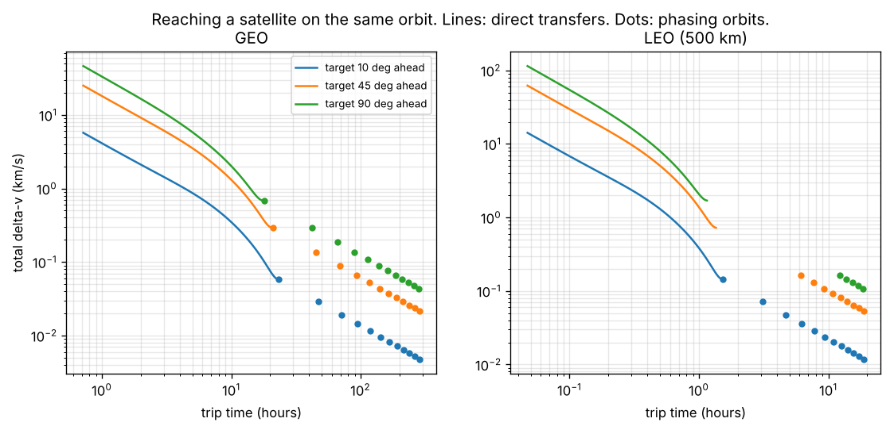

# How fast can you reach another satellite, and what does it cost?

A small orbital mechanics study I did after reading about Orbital Operations' high-thrust vehicle.
I wanted to see, in numbers, why thrust matters when you need to get somewhere in orbit quickly.

```
pip install numpy matplotlib
python reach.py                    # prints the tables below
python reach.py --plot example.png # also saves the chart
```



## The setup

A chaser and a target are on the same circular orbit (GEO, or LEO at 500 km), with the target
10, 45 or 90 degrees ahead. Two ways to catch it:

- **Direct transfer** (less than one lap): for a chosen trip time, a Lambert solver finds the
  path that arrives where the target will be. Delta-v counts both burns: leaving, and matching
  the target's velocity on arrival.
- **Phasing orbit**: burn into a slightly smaller, faster orbit, ride it for k laps until you've
  caught up, then burn back. Cheap, but slow.

As a check, the solver reproduces a "transfer" along the orbit itself with zero delta-v
(error around 1e-11 m/s), and the GEO phasing numbers match the usual rule of thumb (about
2.85 m/s per burn for each degree per day of drift).

## Results

**GEO** (one orbit = 23.9 h), total delta-v in m/s:

| trip | 10° ahead | 45° ahead | 90° ahead |
|---|---|---|---|
| 2.4 h direct | 1,783 | 7,701 | 13,745 |
| 7.2 h direct | 567 | 2,213 | 3,515 |
| 12 h direct | 255 | 940 | 1,417 |
| 1 lap phasing (18 to 23 h) | 59 | 293 | 689 |
| 4 laps phasing (about 4 days) | 14 | 66 | 137 |

**LEO** is about 15 times faster for the same delta-v (one orbit is 1.6 h), but phasing orbits
for big angles would dip below 200 km altitude, so you need either more laps or a direct transfer.

**How long it takes just to do the burn:**

| delta-v | electric thruster (0.0002 m/s²) | small chemical (0.05 m/s²) | launch-vehicle class engine (5 m/s²) |
|---|---|---|---|
| 100 m/s | 5.8 days | 33 min | 20 s |
| 500 m/s | 29 days | 2.8 h | 1.7 min |
| 1,500 m/s | 87 days | 8.3 h | 5 min |

## What I took from it

- **Speed is expensive and nonlinear.** In GEO, reaching a target 45° away in 7 hours costs about
  2.2 km/s. Taking 4 days instead costs 66 m/s, roughly 30 times less.
- **Low thrust rules out fast trips entirely**, not just makes them slower. The 7-hour, 2.2 km/s
  trip needs that delta-v delivered in a small fraction of the trip. An electric thruster would
  need over 4 months to burn it.
- **That's the case for high thrust**: it's the only way the left side of the chart is
  reachable. The catch is that the delta-v budget, not the engine, becomes the limit, which is
  probably why reusability and refueling matter so much for this kind of vehicle.

Simplifications: two-body gravity only, coplanar circular orbits, instant burns, and
single-lap direct transfers. Next I'd add plane changes (much more expensive) and finite-burn
losses for the electric case.

Built with help from Claude.
