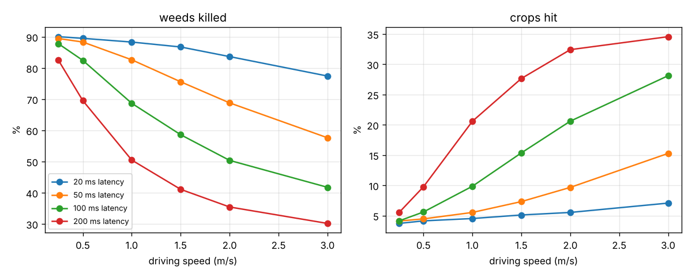

# How fast can a weeding robot drive?

A timing simulation I built after reading about Red Barn Robotics. A weeding robot sees a plant
with a front camera, decides weed or crop, and fires a tool mounted behind the camera when the
weed passes underneath. I wanted to know what actually limits driving speed.

```
pip install numpy matplotlib
python weeder.py                    # prints the tables below
python weeder.py --plot example.png # also saves the chart
```



## The model

- Crops every 30 cm, 8 weeds per meter scattered randomly, 200 m of row per run.
- Camera is 0.5 m ahead of the tool. The tool treats a 1.5 cm radius spot; hitting within 5 cm
  of a crop stem counts as hitting the crop.
- Sources of timing error:
  - detection latency, with ±25% jitter
  - 3% wheel slip, so the robot's speed estimate is a little off
  - 15 ms tool actuation, ±20%
  - a classifier that finds 95% of weeds and calls 2% of crops weeds
- The robot compensates for its average latency and actuation time, but can't know the jitter
  or the slip.

## Results (20 runs per cell): weeds killed / crops hit

| latency | 0.25 m/s | 0.5 m/s | 1 m/s | 1.5 m/s | 2 m/s | 3 m/s |
|---|---|---|---|---|---|---|
| 20 ms | 90% / 3.7% | 90% / 4.1% | 88% / 4.5% | 87% / 5.1% | 84% / 5.5% | 77% / 7.1% |
| 50 ms | 89% / 4.1% | 88% / 4.5% | 83% / 5.5% | 76% / 7.3% | 69% / 9.7% | 58% / 15.3% |
| 100 ms | 88% / 4.1% | 82% / 5.6% | 69% / 9.9% | 59% / 15.4% | 50% / 20.6% | 42% / 28.1% |
| 200 ms | 83% / 5.5% | 70% / 9.8% | 50% / 20.6% | 41% / 27.6% | 35% / 32.4% | 30% / 34.6% |

What limits it at 1 m/s with 50 ms latency (83% killed to start):

| change | weeds killed | crops hit |
|---|---|---|
| no wheel slip | 93% | 3.1% |
| no latency jitter | 90% | 4.0% |
| perfect classifier | 85% | 3.9% |
| latency not compensated at all | 23% | 32.2% |

## What I took from it

- **Latency jitter matters more than latency itself.** The robot can subtract a known delay,
  but jitter turns straight into position error, and that error grows with speed. Going from
  50 ms to 20 ms of latency (with jitter scaling along) doubled the speed at the same
  kill rate (83% at 1 m/s vs 84% at 2 m/s).
- **Wheel slip was the biggest single error source**, bigger than classifier mistakes. A 3%
  speed error over the 0.5 m from camera to tool is about 1.5 cm, the same as the tool's
  radius. Measuring ground speed directly (optical flow from the camera, say) or moving the
  tool closer to the camera would help more than a better model.
- **Forgetting to compensate for latency is catastrophic** (23% killed). That's the kind of bug
  that would look like a bad classifier.

Simplifications: one dimension (along the row only), a single tool, and made-up but plausible
numbers. The next step would be adding sideways error and checking these numbers against real
hardware timing.

Built with help from Claude.
